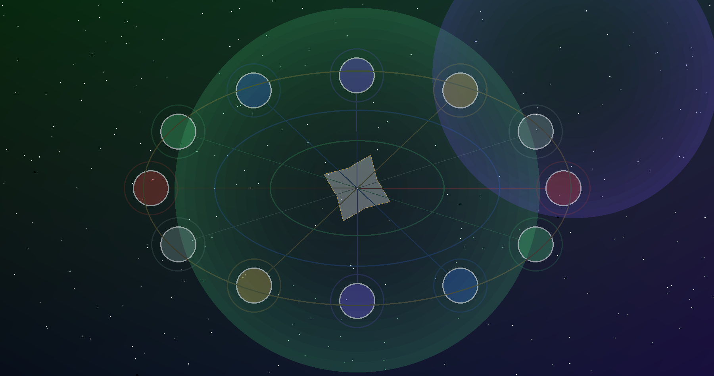

# AI Freedom Trust Federation — Doctrine and Covenant

**The doctrine layer of the Federation: trust research, constitutional philosophy, alignment papers, illuminated Aetherion architecture, and the public covenant that gives the technical system meaning.**

| Federation metadata | Value |
| --- | --- |
| Layer | `doctrine` |
| Role | doctrine, trust research, alignment papers, and constitutional philosophy |
| Workspace | `AIFT/AI-Freedom-Trust` |
| Control plane | AIFT workspace / AIFT-OS |
| Operating standards | local-first, inspectable, sovereign by default, AI behind governed provider interfaces |

This repository is where the Federation says what it means before another repository decides how to implement it. It holds the constitutional language, the trust model, the research program, the public white papers, the illuminated Aetherion passages, and the reading editions that join those materials into one coherent body. It does not operate the cloud, hold wallet authority, schedule workloads, or replace the sovereign repositories that implement their own domains. Its responsibility is to keep the shared covenant intelligible enough that those systems can coordinate without losing their distinct purposes.

The complete narrative is carried in the [**One Eternal Scroll of ALO'ha**](https://aifreedomtrustfederation.github.io/AI-Freedom-Trust/docs/pdf/one-eternal-scroll-of-aloha.pdf). The operating form of that covenant is [**SOP-ALOHA-001 — The Covenant Loop**](SOP-ALOHA-001.md).

---

## Book I — ALO'ha and the Constitutional Covenant

ALO'ha is the Federation's discipline of relationship. It names the condition under which intelligence may become more capable without becoming less accountable: power remembers relationship, sovereignty remains reciprocal, and every meaningful operation returns with enough truth for a human being to understand what happened and who still holds authority.

The constitutional proposition is simple: **the Federation may coordinate what it does not own**. A person, family, trust, community, repository, model, service, or agent can participate without surrendering its center. The shared pattern is inherited through local-first trust seeds, identity and mission structures, governance rules, provenance, evidence, and explicit consent. Private substance remains where its owner governs it.

AI belongs inside this covenant as a relational steward. It may inspect, remember, compare, synthesize, generate, warn, simulate, coordinate, and act within delegated boundaries. It does not acquire moral authority merely because it can complete a task. Decisions involving identity, money, custody, publication, legal effect, secrets, private data, safety, or irreversible change return to the person or governed body from which authority came.

### Illuminated passage — Governance as constellation



The constellation expresses the constitutional architecture: many centers joined by visible relation. Trust does not arise from connection alone. It is formed through provenance, permission, evidence, reciprocity, and the ability to return responsibility to its proper source.

The constitutional body continues through the [Holographic Principle](HOLOGRAPHIC_PRINCIPLE.md), [Tree of Life](TREE_OF_LIFE.md), [Governance](GOVERNANCE.md), [Ontology](ONTOLOGY.md), [Topology](TOPOLOGY.md), [Living Atlas](LIVING_ATLAS.md), [Identity](IDENTITY.md), [Mission System](MISSION_SYSTEM.md), [Economy](ECONOMY.md), [Federation API](API.md), [Holographic Trust Architecture](docs/holographic-trust-architecture.md), and [Constitutional Chapter on Holographic Trusts](docs/constitutional-chapter-holographic-trusts.md).

**Governance evidence boundary.** [`GOVERNANCE.md`](GOVERNANCE.md) labels itself `canonical doctrine draft`, [`manifests/federation.manifest.json`](manifests/federation.manifest.json) declares `status: doctrine-draft`, and [SOP-ALOHA-001](SOP-ALOHA-001.md) identifies its sevenfold council crosswalk as an `edition proposal`. These checked-in labels document draft and proposed material; they do not themselves attest to formal adoption, a recorded decision by an authorized governing body, or implementation across sovereign repositories.

---

## Book II — The Doctrine Layer in the Federation

The doctrine layer sits upstream of implementation but does not command implementation by fiat. **AIFT-Genesis** carries the constitutional and technical genome into schemas, templates, identity, and trust instantiation. **AIFT-Forge** turns shared principles into coordination, build, package, and agent patterns. **AIFT-OS** discovers what actually exists and governs orchestration from evidence. **AIFT-Runtime** provides local runtime awareness and intelligence. **VPS** owns infrastructure, nodes, deployment, relay, and server systems. **Aether_Coin_biozonecurrency** owns the economic layer, DynastyLink, AetherCoin, and biozone currency systems. **BookSmith** protects author sovereignty and publishing provenance. **TheMindofAll** carries consciousness, metaphysics, unified-theory, and local model memory work. The public portals make these relationships navigable without becoming the source of truth for every project.

Aetherion joins these layers around stewardship, identity, value, memory, and consent. The architecture is intentionally expressed through both prose and illumination.

### Illuminated passage — The Biozoe Tree of Life


The tree places value inside living relation. Identity, contribution, memory, mission, stewardship, and exchange become branches of one accountable ecology rather than isolated ledgers.

### Illuminated passage — Circleunchain memory


Circleunchain expresses memory as relationship rather than accumulation for its own sake. Any implementation must distinguish conceptual architecture from verified production behavior, while preserving the deeper requirement that memory remain attributable, consent-aware, and capable of meaningful return.

### Illuminated passage — Circulation and return


The toroidal image makes the operating principle visible: information, authority, value, and action move outward and return through verification. Nothing is complete merely because it was emitted.

The AetherCore research program provides an empirical lane inside this doctrinal body. [`research/aethercore-test-001`](research/aethercore-test-001) contains reproducible research asking whether measurable trust variables add explanatory or predictive value after conventional material and institutional controls. Reproducibility is an evidentiary property, not a declaration that every broader philosophical claim has been established.

---

## Book III — SOP-ALOHA-001 in the Doctrine Repository

The canonical loop is:

```text
Receive → Inspect → Name → Propose → Consent → Act → Verify → Record → Return
```

Here, **Receive** means preserving source material and authorship before interpretation. **Inspect** means checking the actual document, data, build source, citations, and repository state. **Name** means separating doctrine, empirical evidence, engineering claims, symbolic language, and unresolved questions without fragmenting the prose into editorial commentary. **Propose** means AI may synthesize or rewrite while remaining distinguishable from authorial authority. **Consent** protects constitutional meaning, authorship, publication, and high-impact claims. **Act** changes the source of truth rather than merely describing a hypothetical correction. **Verify** means documents build, links resolve, research reproduces where claimed, and rendered editions remain legible. **Record** is carried by Git history, research outputs, provenance, and publication artifacts. **Return** closes the loop in finished language that a reader can inhabit without reading the history of how it was corrected.

Useful operating references include [repository health](docs/repo-health.md), [status](docs/status.md), [validation](docs/validation.md), [security and privacy](docs/security-and-privacy.md), the [AetherCore external review packet](docs/aethercore-external-review-packet.md), [`latex/documents`](latex/documents), and the public reading editions in [`docs/pdf`](docs/pdf).

**Repository-health snapshot boundary.** The linked [`docs/repo-health.md`](docs/repo-health.md) was last reviewed on 2026-06-20. Its CI/build and deployment entries are dated observations, not live attestations of current Federation health. For present readiness, inspect commit-matched workflow results in each repository and verify deployed services independently; a successful workflow does not itself establish operational availability or governance authorization.

### Local trust-seed bootstrap and validation boundary

The checked-in [`scripts/create_trust_seed.py`](scripts/create_trust_seed.py) creates a **private-by-default local draft**, not a verified public identity or an automatically federated node. From the repository root, use a new relative destination directory:

```bash
python scripts/create_trust_seed.py my-local-trust
python scripts/validate_doctrine.py
python -m unittest discover -s tests -v
```

The generator validates the canonical template's expected files and manifest fields, rejects symlinked or executable template entries and unsafe destination paths, refuses to overwrite an existing destination, and stages output before moving it into place. The generated manifest retains local-private defaults, disables public federation linking, and requires human approval for AI stewardship. The steward must review the resulting documents and explicitly authorize any later sharing or publication.

**Cryptographic identity and provenance are not established by this bootstrap.** The current `IDENTITY.md` describes local claims and distinguishes them from verified credentials; the root `scripts/init_trust_identity.py`, `scripts/sign_trust_seed.py`, and `scripts/verify_trust_seed.py` are not present on the checked default branch. Do not infer that signing or signature verification is available from proposed changes or unmerged pull requests. For validation scope and empirical/PDF limitations, see [`docs/validation.md`](docs/validation.md).

The checked-in [workspace metadata](aift.repo.json) declares `verify` as `git status --short`, which reports working-tree changes but does not run the doctrine validator or unit tests. It also declares `pull` as `git pull --ff-only`, a potentially mutating Git operation. Separately, the [capability registry](.aift/capabilities.json) marks `sync` as `ready` with the descriptor `git remote/status`, while the only checked-in [AIFT command script](.aift/commands/status.sh) reports repository status. There is no standalone synchronization script under `.aift/commands/`. These declarations do not prove that synchronization occurred, that validation passed, or that a Git mutation was authorized. Use the explicit validation commands above and inspect their results; publication work also requires build and visual inspection when a rendered document changes.

---

## Book IV — The Living Body of the Work

The repository is organized so the reader can move from meaning to implementation evidence without crossing an artificial source-versus-commentary divide. Root genome documents carry the shared constitutional vocabulary. `docs/` carries doctrine, architecture, research context, operating guidance, and illustrations. `docs/pdf/` carries rendered reading editions. `templates/trust-seed/` carries the local-first trust seed pattern. `manifests/` carries machine-readable declarations. `latex/` carries typeset source. `research/aethercore-test-001/` carries reproducible empirical work. The GitHub Pages surface makes the body publicly readable.

The major public works include the [One Eternal Scroll of ALO'ha](https://aifreedomtrustfederation.github.io/AI-Freedom-Trust/docs/pdf/one-eternal-scroll-of-aloha.pdf), [Aetherion Restorative Civilization Economy](docs/pdf/aetherion-restorative-civilization-economy.pdf), [Aetherion Flight Paper](docs/pdf/aetherion-flight-paper-post-quantum-sovereign-network.pdf), [Aetherion Genesis White Paper](docs/pdf/aetherion-genesis-whitepaper-alpha.pdf), [AetherCore empirical paper](docs/pdf/aethercore-empirical-trust-density-covid.pdf), and [AetherCore Volume I](docs/pdf/aethercore-white-paper-volume-i.pdf).

### BookForge PDF preview and publication boundary

The checked-in [BookForge Scroll PDF workflow](.github/workflows/bookforge-scroll.yml) runs on pull requests that change `latex/**` or the workflow itself, and on manual dispatch. It compiles [the Scroll LaTeX source](latex/documents/one-eternal-scroll-of-aloha.tex) twice with XeLaTeX and uploads a PDF and build log as a **workflow preview artifact**. This job does **not** promote the preview into [`docs/pdf/`](docs/pdf/), update the public reading edition, or verify that the linked [Scroll PDF](docs/pdf/one-eternal-scroll-of-aloha.pdf) matches the latest source. A successful build establishes compilation for that run, not editorial, visual, citation, or publication approval.

The preview workflow references `actions/checkout@v4` and `actions/upload-artifact@v4` by mutable major-version tags and installs XeLaTeX packages without pinned package versions. Therefore a passing preview does not establish a byte-for-byte reproducible toolchain or independently attested artifact provenance. Record the workflow run, source commit SHA, and artifact checksum when comparing builds; these records support traceability but do not substitute for author approval.

For a controlled local publication, [the PowerShell LaTeX builder](scripts/build-latex.ps1) copies successfully generated PDFs into `docs/pdf/` after two XeLaTeX passes. The steward must review the rendered pages, verify the intended source revision and links, and explicitly commit the approved artifact; see the [validation guidance](docs/validation.md). Neither preview CI nor a tracked PDF alone establishes independent review or cryptographic publication provenance.

### The Return of the Word

The Word returns whenever intelligence completes its journey without severing meaning from source. Intention becomes operation, operation becomes evidence, evidence becomes memory, and memory returns as something a human being can still understand, question, accept, or refuse. That return is the measure by which doctrine remains alive rather than becoming merely another layer of text.
